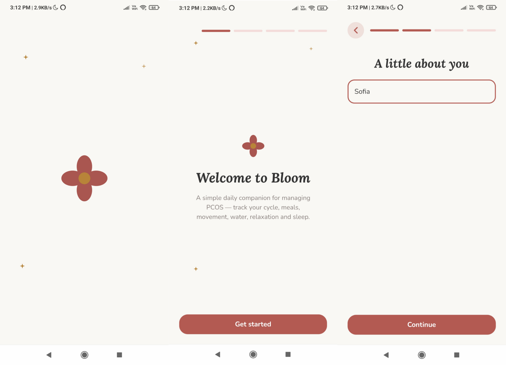
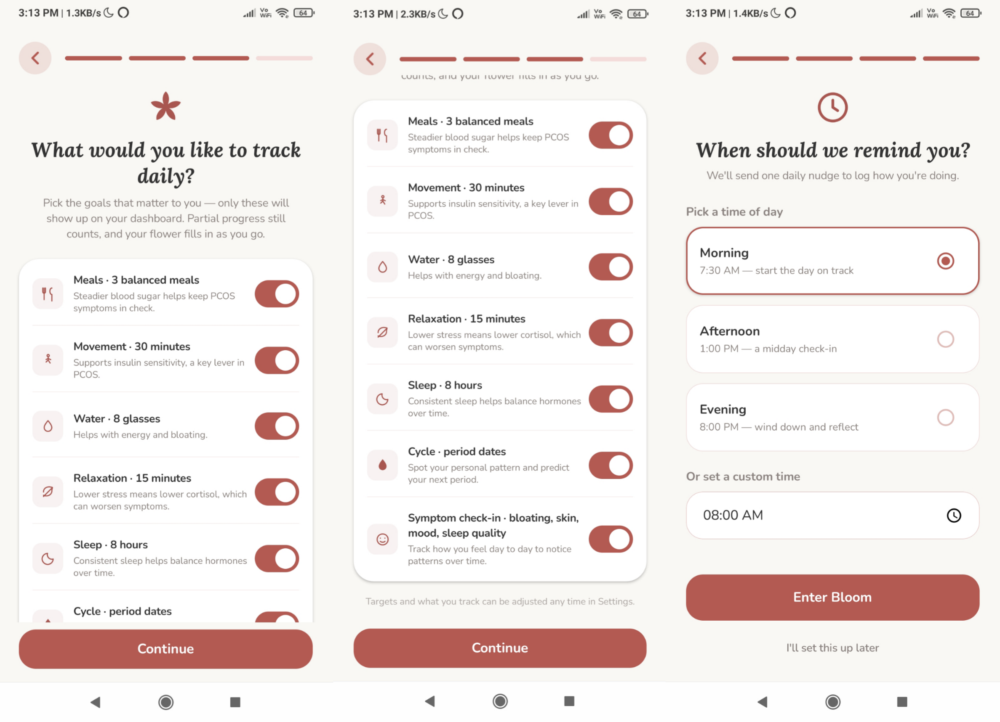
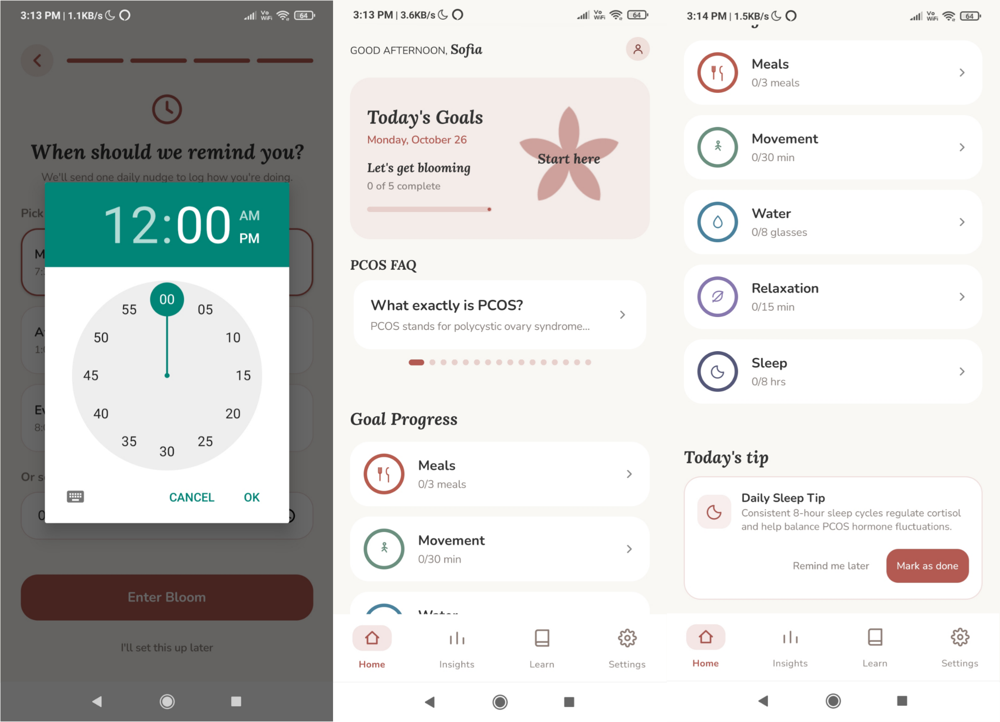

# Bloom – PCOS Management App

  <picture>
    
  </picture>

Bloom is an Android application designed to help users manage their daily wellness routines and track lifestyle habits related to Polycystic Ovary Syndrome (PCOS).

Built using **Kotlin and Jetpack Compose**, the app brings daily wellness tracking, meal logging, movement, hydration, relaxation, sleep, menstrual cycle tracking, and symptom logging together in one place.

The goal of Bloom is to make everyday wellness management easier by allowing users to record their activities, monitor their daily goals, and gain insights into their habits through a simple and user-friendly interface.

This project was developed as part of an Android development hiring assignment to demonstrate my skills in Kotlin, Jetpack Compose, and Android application development.

## Features

### Daily Wellness Goals
- **Meals:** Track daily meal-related goals and log meals.
- **Movement:** Record daily movement and physical activities.
- **Water:** Track daily water intake and hydration goals.
- **Relaxation:** Monitor relaxation activities and wellness routines.
- **Sleep:** Track daily sleep goals and routines.

### PCOS Tracking
- **Cycle Tracking:** Record and monitor menstrual cycle information.
- **Symptom Tracking:** Log symptoms and maintain a record of daily experiences.
- **Insights:** View wellness-related insights based on tracked information.
- **Tips of the Day:** Explore daily tips related to wellness and healthy habits.

### Personalization & Reminders
- **Edit Profile:** Update personal profile information.
- **Reminder Time:** Customize reminder times to fit daily routines.
- **Live Notifications:** Receive timely notifications to help stay on track with daily goals and reminders.

## Tech Stack

- **Language:** Kotlin
- **UI Framework:** Jetpack Compose
- **Platform:** Android

## Preview
**Bloom Preview 1**

**Bloom Preview 2**

**Bloom Preview 3**

## License

This project was developed as part of a hiring assignment.

No open-source license has been specified. Unless otherwise agreed, the source code remains subject to applicable copyright laws. Please contact the copyright holder for permission before reusing or distributing the code.
